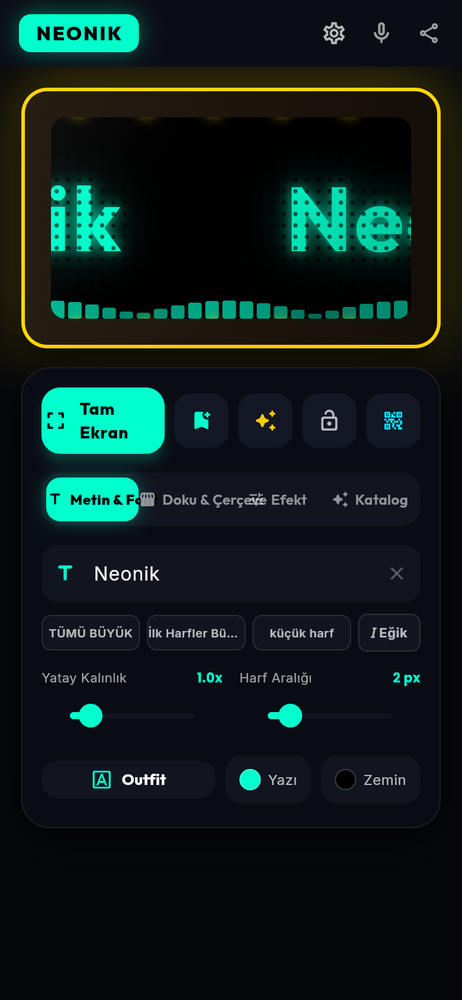
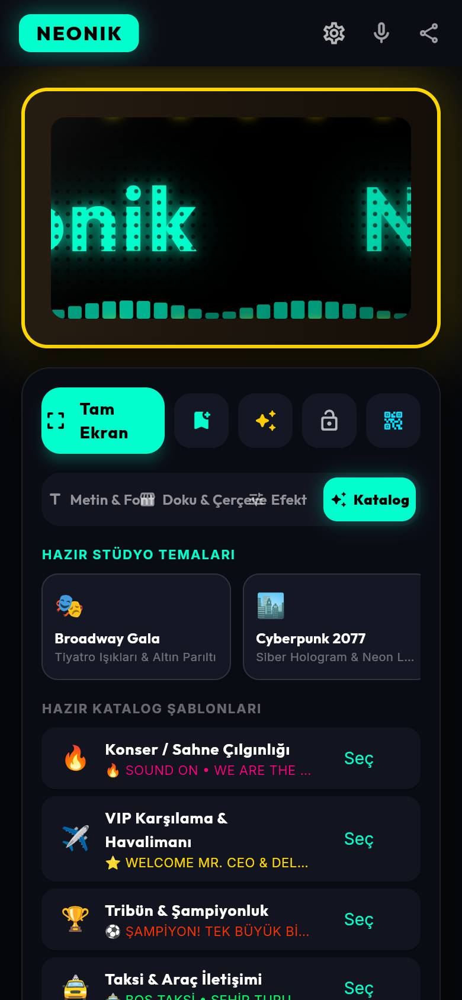
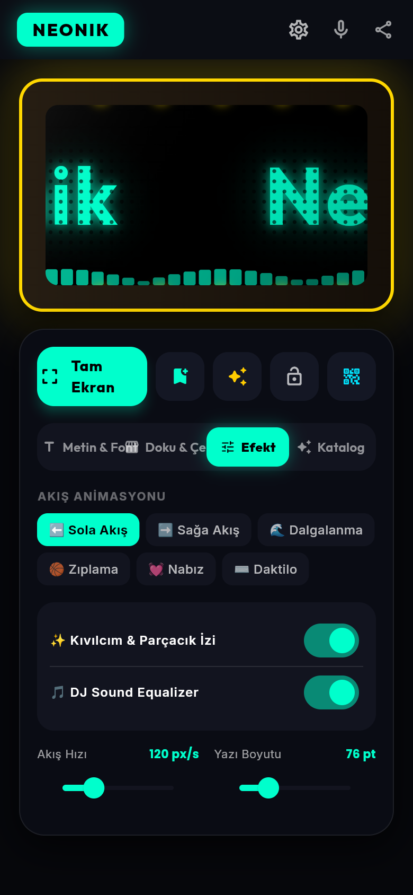

<p align="center"><a href="https://oidioom.com"></a></p>

<h1 align="center">✨ Neonik</h1>

<p align="center"><b>Turn your phone into a glowing neon / LED marquee sign.</b></p>

<p align="center">
  
  
  
  
  
  
  <a href="https://oidioom.com"></a>
</p>

<p align="center"><a href="#-english">🇬🇧 English</a> · <a href="#-türkçe">🇹🇷 Türkçe</a></p>

---

## 🇬🇧 English

Neonik lets you write any message and display it full-screen as a neon LED sign — perfect for concerts, airports, stadiums, taxis or shop windows. Pick colors, fonts and effects, or start from ready-made studio themes.

> [!NOTE]
> This is a **showcase repository**. Neonik is closed-source; this repo contains the project overview, screenshots and a few short code excerpts.

## ✨ Features

- 🔠 Live LED marquee preview with full-screen mode
- 🎨 Color picker, Google Fonts and text styling
- ✨ Effects, textures and frames
- 📚 Ready-made studio themes & templates (concert, VIP, stadium, taxi, SOS…)
- 🔒 Touch-lock overlay
- 📲 Share as QR code

## 📸 Screenshots

<table>
<tr><td align="center"><br><sub>Editor</sub></td><td align="center"><br><sub>Catalog</sub></td><td align="center"><br><sub>Effects</sub></td></tr>
</table>

## 🧩 Code Showcase

A few real, short excerpts from the codebase — each with a note on what it does and where it is used. See the [`showcase/`](showcase) folder.

**[`morse_encode.dart`](showcase/morse_encode.dart)** — Encodes any text into Morse code for the blinking Morse effect. _Used by the 'Morse' effect in the effects panel._

```dart
class MorseHelper {
  static String encode(String text) {
    return text
        .toUpperCase()
        .split('')
        .map((char) => morseMap[char] ?? char)
        .join(' ');
  }
}
```

**[`slogan_template.dart`](showcase/slogan_template.dart)** — A ready-made catalog template: title, icon, text, color and font. _Templates like this fill the 'Catalog' tab._

```dart
{
  'title': 'Konser / Sahne Çılgınlığı',
  'icon': '🔥',
  'text': '🔥 SOUND ON • WE ARE THE MUSIC MAKERS ⚡🎸',
  'textColor': 0xFFFF007F,
  'font': 'Orbitron',
},
```

## 🛠️ Built With

Flutter · Dart · google_fonts · flutter_colorpicker · qr_flutter

## 📄 License

© 2026 Oidioom / Tarek Sharabaty. All rights reserved. See [LICENSE](LICENSE).

---

## 🇹🇷 Türkçe

**Telefonunuzu parlayan bir neon / LED kayan yazı tabelasına dönüştürün.**

Neonik ile istediğiniz mesajı yazıp tam ekran neon LED tabela olarak gösterebilirsiniz. Konserler, havalimanları, tribünler, taksiler veya vitrinler için idealdir. Renk, yazı tipi ve efekt seçin ya da hazır stüdyo temalarıyla başlayın.

> [!NOTE]
> Bu bir **vitrin (showcase) deposudur**. Neonik kapalı kaynaklıdır; bu depoda proje tanıtımı, ekran görüntüleri ve birkaç kısa kod alıntısı bulunur.

## ✨ Özellikler

- 🔠 Tam ekran modlu canlı LED kayan yazı önizlemesi
- 🎨 Renk seçici, Google Fonts ve yazı stilleri
- ✨ Efektler, dokular ve çerçeveler
- 📚 Hazır stüdyo temaları ve şablonlar (konser, VIP, tribün, taksi, SOS…)
- 🔒 Dokunma kilidi
- 📲 QR kod ile paylaşma

## 🧩 Kod Vitrini

Kod tabanından kısa ve gerçek alıntılar; kodlar yukarıdaki İngilizce bölümde gösterilmiştir. Hepsi [`showcase/`](showcase) klasöründe:

- **[`morse_encode.dart`](showcase/morse_encode.dart)** — Yanıp sönen Mors efekti için metni Mors koduna çevirir. _Efekt panelindeki 'Mors' efektinde kullanılır._

- **[`slogan_template.dart`](showcase/slogan_template.dart)** — Hazır bir katalog şablonu: başlık, ikon, metin, renk ve yazı tipi. _Bu tür şablonlar 'Katalog' sekmesini doldurur._

## 🛠️ Kullanılan Teknolojiler

Flutter · Dart · google_fonts · flutter_colorpicker · qr_flutter

## 📄 Lisans

© 2026 Oidioom / Tarek Sharabaty. Tüm hakları saklıdır. Ayrıntılar için [LICENSE](LICENSE).

---

<p align="center"><a href="https://oidioom.com"></a></p>
<p align="center"><b>by Oidioom — Tarek Sharabaty</b><br>
<a href="https://oidioom.com">oidioom.com</a> · <a href="https://github.com/tariksharabaty">GitHub</a> · <a href="https://modrinth.com/organization/oidioomstudio">Modrinth</a> · <a href="https://gear.oidioom.com">Gear</a> · <a href="https://www.instagram.com/oidioom">Instagram</a></p>
